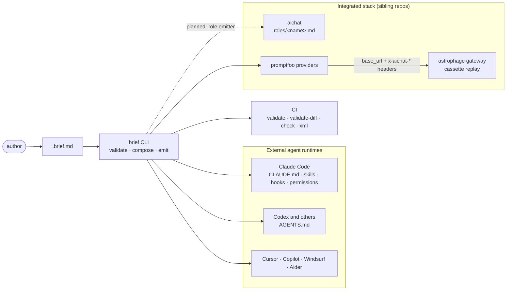
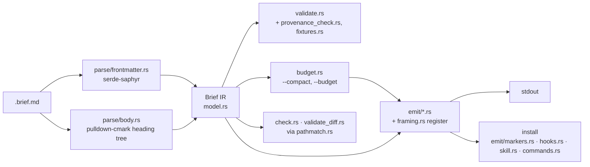

# brief architecture

brief is the source of record for human intent to AI systems. It serves two groups of
consumers: the coding agents (through `AGENTS.md`, `CLAUDE.md` and each tool's native
files) and the integrated Eridian stack of six repos. It does three jobs: it compiles a
`.brief.md` into each consumer's artifact, installs that artifact reversibly, and gates
work against it. It never runs a model, holds a session, or calls the network, and
nothing a consumer does flows back into brief. The ownership table and non-goals are in
[design-decisions.md](../design-decisions.md) "Place in the integrated system".

The integrated system is described from aichat's side in its
[`architecture.svg`](https://github.com/jikanter/aichat-private/blob/main/docs/architecture.svg)
and [`ROADMAP.md`](https://github.com/jikanter/aichat-private/blob/main/docs/ROADMAP.md).
aichat names brief its primary composition language and lists the brief → aichat seam as
"emitted files only; brief never executes". This page is the same picture from brief's side.

## 1. Where brief sits

Dashed means planned. There are no arrows into brief: every seam is a file brief
writes, and no consumer calls brief back.

## 2. Seams

| Seam | Consumer | Contract | Status |
|---|---|---|---|
| Standing instructions (`AGENTS.md`, `CLAUDE.md`) | every coding agent | Augment only: brief writes inside its own `<brief:generated>` region and nothing else. Claude Code reads `AGENTS.md` only when the repo has no `CLAUDE.md` ([design-decisions.md](../design-decisions.md) "Which standing file Claude Code reads"). | Shipped |
| `CLAUDE.md` section, skill, hooks, permissions | Claude Code | `<brief:generated>` markers; `.claude/skills/<name>/SKILL.md`; `PreToolUse` hook running `brief check`; `permissions.allow` from `## Commands` | Shipped |
| `AGENTS.md`, `.cursor/rules/`, `.github/copilot-instructions.md`, `.windsurf/rules/`, `CONVENTIONS.md` | the other external runtimes | One idiomatic file or managed section each; see [emit-targets-reference.md](../emit-targets-reference.md) | Shipped |
| promptfoo providers | promptfoo, then astrophage | `openai:chat:<model>` (default) or `http` (`--session-id`) providers; `x-aichat-cache-mode: cassette`, `x-aichat-cassette: <set>`, optional `X-Eridian-Session-Id`; `--gateway` address | Shipped (aichat Phase 48A/B) |
| aichat role | aichat | `roles/<name>.md`: YAML frontmatter plus prompt body. The file is hashed into the Entity `lock_hash`, and `tool_approval` rules in its frontmatter can only tighten policy. An agent-directory emitter (`agents/<name>/`, the 2026-04 [backend audit](../design/backends/aichat/README.md)) is deferred until agent formats settle. | Planned (decided 2026-09-27) |
| Eval suite | aichat role evaluation or promptfoo | Undecided (aichat integration idea #7) | Open |
| Parsed brief (JSON) | any tool | [`brief-v1.schema.json`](../schema/brief-v1.schema.json), [SPEC.md](../schema/SPEC.md) | Shipped |
| CI gates | any CI | `brief validate`, `brief validate-diff`, `brief check` exit codes; `emit xml` for prompts that carry untrusted content | Shipped |
| Hermes | none | aichat's metadata refinery owns the aichat ↔ Hermes boundary and moves only a role's description. brief reaches Hermes only through aichat. | By design |
| ACE / ClaudeKb | none (brief points only) | A brief may point at ClaudeKb paths or `ace://` facts from `context:`; retrieval happens in aichat. brief never files, indexes or curates tags. Today `brief validate` warns on any `context:` entry that is not a local file, URLs included, and `emit claude` renders it as an `@` import. | Gap: URI-aware `context:` |

brief has no seam with llm-functions, rocky or pi. Tools are declared in llm-functions and
referenced by name from a role; rocky reads aichat's traces; pi is the REPL over aichat.

## 3. Inside brief

| Module | Job |
|---|---|
| `parse/` | Split frontmatter from body; build the heading tree. Tolerant: unknown sections are kept verbatim. |
| `model.rs` | The `Brief` IR every other module reads. `Frontmatter` derives the committed JSON Schema (`schema.rs`). |
| `validate.rs`, `provenance_check.rs` | Errors and warnings; provenance keys are advisory only. |
| `fixtures.rs` | Cassette bindings from `cassettes:` and `## Fixtures`. |
| `framing.rs` | The register pass: Hard → `NEVER:`/`MUST:`, Soft → `PREFER:`, Ask First → `STOP and confirm`. |
| `budget.rs` | Token and character estimates per target; `--compact`. |
| `emit/` | One module per target. Each takes `&Brief` and returns a `String`. |
| `emit/markers.rs`, `hooks.rs`, `skill.rs`, `commands.rs` | Install surfaces: managed sections, hook registration, skills, command permissions. |
| `conflict.rs` | Warns when a constraint contradicts the host file it is installed into. |
| `pathmatch.rs`, `check.rs`, `validate_diff.rs` | Sacred and scope matching, the one path matcher every gate uses. |

## 4. Invariants

Every change keeps these. They are the charter's Hard constraints in `.brief.md`, stated
as properties of the code:

1. **Emit only.** No model client, session store, tool loop or network crate. A test in
   `tests/cassette_tests.rs` fails if `Cargo.toml` gains `tokio`, `reqwest`, `hyper` or
   `ureq`.
2. **Deterministic.** The same brief gives byte-identical output. The one clock read,
   `skill::now_utc`, stamps skill install metadata and must not reach an emitter. This
   matters most for the aichat target, whose output is hashed into `lock_hash`.
3. **Reversible.** Anything `--install` writes, `--uninstall` removes, and nothing outside
   brief's markers or brief-owned files is touched.
4. **Seams are files.** A sibling repo that needs a change gets it documented here and
   built there; brief never edits another repo, and another repo never edits brief.

Roadmap and gaps: [../design/new-surfaces-design-doc.md](../design/new-surfaces-design-doc.md).
Settled decisions: [../design-decisions.md](../design-decisions.md).
